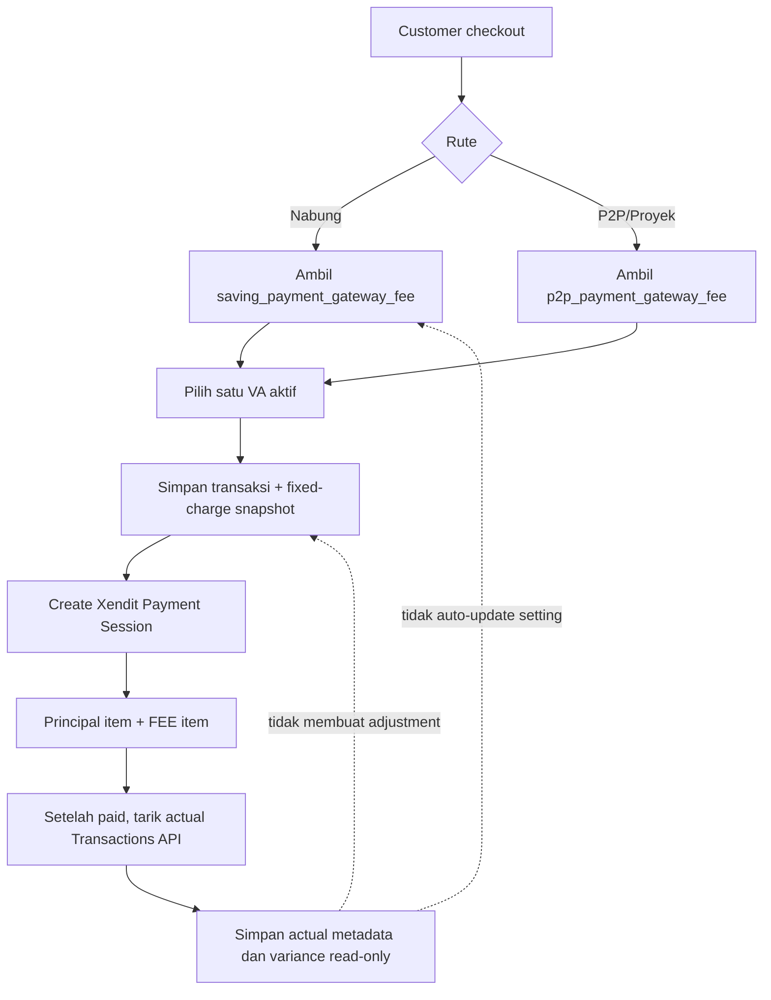

# Xendit Fixed Charge per Route — Changelog & AI Review Handoff

Tanggal perubahan: 6 Agustus 2026  
Status: menggantikan perilaku checkout versioned-rate/auto-adjustment

Verifikasi lokal:

- migration drift check: tidak ada perubahan yang belum dibuat;
- seluruh 171 test lulus;
- warning yang tersisa adalah warning kompatibilitas Treebeard/Wagtail existing
  dan warning Draftail feature existing, bukan kegagalan payment flow.

## Prompt siap diberikan ke AI reviewer

> Review implementasi current-state Xendit fixed charge berdasarkan
> `docs/xendit-fixed-charge-system-ai-review.md`. Verifikasi source code, jangan
> hanya mempercayai changelog. Telusuri end-to-end flow Nabung dan P2P/Proyek,
> khususnya pemisahan nominal charge per rute, pilihan VA, snapshot immutable,
> metadata Xendit, serta penutupan auto-learning dan adjustment. Laporkan temuan
> actionable P0–P3 lengkap dengan file/baris, skenario reproduksi, dampak bisnis,
> dan rekomendasi perbaikan terkecil. Jangan implementasikan fix sebelum diminta.

## Keputusan bisnis current-state

- Customer tetap memilih satu bank Virtual Account sebelum Payment Session dibuat.
- Pilihan bank hanya menentukan `allowed_payment_channels`; pilihan bank tidak
  menentukan nominal fee.
- Customer dikenakan nominal fixed charge di awal.
- Fixed charge Nabung dan P2P/Proyek memiliki setting yang berbeda.
- Selisih antara charged fee dan actual Xendit fee merupakan margin/shortfall
  operasional yang hanya dicatat untuk observasi.
- Actual fee tidak boleh otomatis mengubah setting checkout.
- Posting dan allocation adjustment dinonaktifkan.
- Struktur dan histori rate/adjustment lama tidak dihapus agar audit trail tetap ada.

## Alur aktif



## Changelog

### 1. Setting fixed charge per rute

`XenditSetting` sekarang mengekspos:

- `saving_payment_gateway_fee` untuk transaksi Nabung;
- `p2p_payment_gateway_fee` untuk pembayaran P2P/Proyek.

Keduanya Decimal non-negatif dan tampil dalam panel **Biaya yang dibebankan ke
customer**. Default migration adalah Rp2.750 per rute; operator wajib mengubah
nominal production sesuai keputusan bisnis sebelum menerima checkout baru.

### 2. Fee tidak lagi berasal dari bank/rate

`resolve_fee()` tetap memvalidasi selected VA terhadap boolean global dan per
rute, tetapi nominal charge hanya dibaca dari field setting sesuai rute.
Akibatnya BCA dan BNI pada rute yang sama menghasilkan fee identik, sedangkan
Nabung dan P2P dapat menghasilkan fee berbeda.

Master `XenditFeeRate` dipertahankan sebagai arsip historis. Transaksi baru
menyimpan `rate = NULL` agar tidak menyatakan bahwa fixed customer charge berasal
dari rate provider.

### 3. Snapshot dan immutability

Setiap transaksi baru menyimpan `charge_configuration_snapshot` yang berisi:

- source `xendit_setting`;
- rute;
- nama field setting;
- configured amount;
- currency;
- selected VA;
- marker bahwa charge bersifat channel-independent.

Snapshot tersebut masuk daftar field immutable setelah `xendit_session_id`
terisi. `service_fee` dan `total_amount` pada transaksi Nabung/P2P juga tetap
immutable sesuai proteksi model sebelumnya.

### 4. Payload Xendit

- Payment Session tetap dikunci ke satu selected VA.
- Principal dikirim sebagai item `DIGITAL_SERVICE`.
- Fixed customer charge dikirim sebagai item `FEE` bila lebih dari nol.
- `amount = principal + fixed charge`.
- Metadata memakai `fee_charge_source=xendit_setting` dan `fee_setting_field`;
  metadata `fee_rate_version` tidak lagi dikirim untuk transaksi baru.

### 5. Reconciliation menjadi observasi read-only

Transactions API tetap ditarik setelah transaksi paid agar actual fee, tax,
settlement, ID provider, gross/net, timestamps, dan raw payload tetap tersedia.

```text
actual_total_fee = xendit_fee + value_added_tax
raw_variance     = charged_fee_total - actual_total_fee
```

Auto-learning telah dilepas dari alur reconciliation. Perubahan actual Xendit fee
tidak membuat, mengganti, atau mengaktifkan `XenditFeeRate`, dan tidak mengubah
dua fixed-charge setting.

### 6. Adjustment ditutup

- Halaman report hanya menerima GET; POST memperoleh HTTP 405.
- Form posting adjustment dihapus dari UI.
- Service publik `post_adjustment_fifo()` selalu menolak dengan ValidationError.
- Tabel, model, allocation, dan record historis tidak dihapus.
- Report/CSV masih dapat menampilkan allocation historis bila sebelumnya sudah ada.

## Invariant yang wajib diverifikasi

- [ ] Nabung selalu memakai `saving_payment_gateway_fee` dari server.
- [ ] P2P selalu memakai `p2p_payment_gateway_fee` dari server.
- [ ] Browser tidak dapat mengirim nominal fee sendiri.
- [ ] Dua VA berbeda pada rute yang sama menghasilkan charge yang sama.
- [ ] VA yang nonaktif untuk rute terkait ditolak.
- [ ] Payment Session hanya menerima selected VA.
- [ ] Jumlah item Xendit sama dengan `amount` Payment Session.
- [ ] Transaksi baru memiliki `rate_id = NULL` dan fixed-charge snapshot lengkap.
- [ ] Perubahan setting hanya memengaruhi transaksi yang dibuat setelah perubahan.
- [ ] Snapshot dan nominal transaksi lama tidak berubah saat setting diedit.
- [ ] Reconciliation menyimpan actual provider data tanpa memutasi setting/rate.
- [ ] Tidak ada endpoint UI atau service aktif yang dapat mem-post adjustment.
- [ ] Record historis rate/adjustment tetap dapat dibaca.
- [ ] Webhook/polling berulang tetap idempotent.

## Review scope

### Konfigurasi dan migration

- `_setting/models/xendit.py`
- `_setting/admin/settings.py`
- `_setting/migrations/0013_fixed_charge_per_payment_route.py`
- `_payment/migrations/0003_fixed_charge_snapshot.py`

### Payment domain

- `_payment/models.py`
- `_payment/views.py`
- `_payment/services/pricing.py`
- `_payment/services/reconciliation.py`
- `_payment/services/adjustments.py`
- `_payment/admin_views.py`
- `_payment/wagtail_hooks.py`
- `_payment/templates/_payment/admin/fee_reconciliation_report.html`
- `_payment/tests/test_payment_fees.py`

### Kedua checkout

- `_product/forms/admin.py`
- `_product/services/saving_workflow.py`
- `_p2p/services/purchase_workflow.py`
- `cms/templates/cms/pages/saving_form.html`
- `cms/templates/cms/section/p2p_purchase_content.html`

## Edge case prioritas

1. Fixed charge bernilai nol.
2. Fixed charge negatif melalui ORM/raw database bypass.
3. Setting berubah setelah transaksi tersimpan tetapi sebelum session dibuat.
4. Dua request checkout bersamaan ketika setting diedit.
5. Selected VA dinonaktifkan di antara quote dan submit.
6. Actual Xendit fee lebih besar, lebih kecil, atau sama dengan fixed charge.
7. Record historis masih memiliki `rate_id` dan allocation adjustment.
8. Admin mencoba POST langsung ke URL reconciliation.
9. Internal code mencoba memanggil `post_adjustment_fifo()`.
10. Migration dijalankan pada database yang sudah memiliki histori fee/rate.

## Deployment checklist

- [ ] Jalankan migration `_setting.0013` dan `_payment.0003`.
- [ ] Atur charge Nabung dan P2P/Proyek secara eksplisit di General Settings → Xendit.
- [ ] Pastikan seluruh VA yang diterima aktif pada rute yang benar.
- [ ] Smoke-test satu checkout Nabung dan satu P2P di Xendit test mode.
- [ ] Pastikan report reconciliation tidak lagi menampilkan form adjustment.
- [ ] Pantau shortfall/margin actual fee sebagai observasi operasional.

## Known boundary

Immutability transaksi dan snapshot berada pada model `save()`. `QuerySet.update`,
raw SQL, dan akses database langsung masih dapat melewati proteksi tersebut karena
belum ada database trigger. Validasi fixed charge non-negatif juga dilakukan oleh
form/model clean dan resolver; akses database langsung tetap menjadi boundary
operasional yang harus dibatasi.

## Format hasil review yang diharapkan

Untuk setiap finding:

```text
[P0-P3] Judul singkat
File: path:line
Scenario: langkah reproduksi
Impact: dampak finansial/data/security
Recommendation: perubahan terkecil yang disarankan
```

Jika tidak ada finding, reviewer harus menyebutkan area yang diperiksa, test yang
dijalankan, residual risk, dan hal yang masih perlu diverifikasi menggunakan akun
Xendit nyata.
